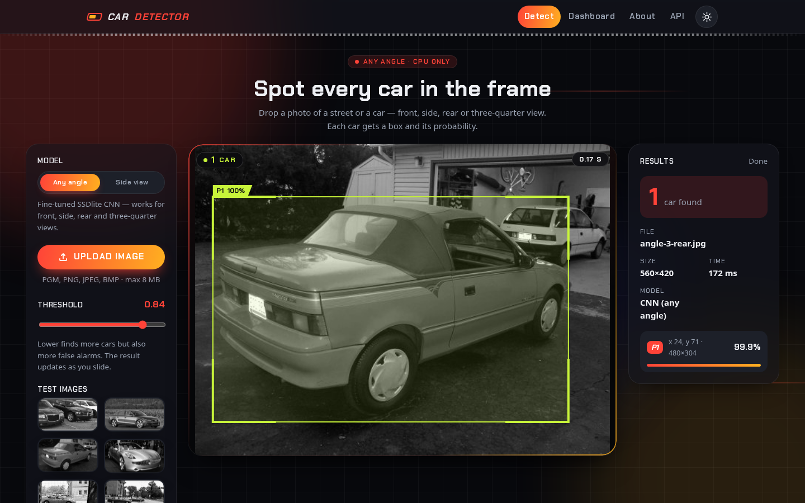

# Car Detector: cars from any angle, on a CPU, end to end

[](https://github.com/sakshipatole28/Car-Detection-Project/actions/workflows/ci-cd.yml)

This project finds every car in an image, whether it's seen from the front,
side, rear or at a three-quarter angle, and draws a box around each one. It
serves two models side by side:

| Model | What it is | Use it for |
|---|---|---|
| **Any angle** (default) | SSDlite MobileNetV3, pretrained on COCO and fine-tuned on a CPU with Stanford Cars plus synthetic UIUC street scenes | Any photo with cars in it |
| **Side view** | HOG features with calibrated logistic regression, scanned as a sliding window at 9 scales | The classical baseline, side views only |

The project also includes the full MLOps setup: **DVC**, **MLflow**,
**FastAPI**, **BentoML**, **Docker** and **GitHub Actions**.

The brief this project answers is in **[PROBLEM_STATEMENT.md](PROBLEM_STATEMENT.md)**.



## Why there are two models

The first version used only HOG. It worked on side-view street scenes and failed
on almost every other photo. The table below shows all three candidates scored
the same way on the same held-out data:

| Model | Stanford test, any angle: AP@0.5 | Recall at the model's threshold | UIUC single-scale F1 | UIUC multi-scale F1 | CPU time per image |
|---|---|---|---|---|---|
| HOG baseline | 0.019 | 3.3% | **0.980** | **0.965** | 0.1–1 s |
| SSDlite, COCO weights only | 0.877 | 88.5% | 0.894 | 0.932 | ~90 ms |
| **SSDlite, fine-tuned (deployed)** | **0.995** | **99.8%** | 0.925 | 0.937 | **~85 ms** |

*Stanford: 400 random test images (seed 0). UIUC: the full official test sets.
Every threshold was chosen on validation data. The source data is
[reports/comparison.json](reports/comparison.json), produced by
[scripts/compare_models.py](scripts/compare_models.py).*

What the table shows:

- **HOG really does fail away from side views.** It finds 3% of the cars in
  the Stanford photos. That is why the any-angle model exists.
- **Fine-tuning is worth it.** On the full 1,618-image Stanford test split,
  AP@0.5 rises from 0.877 to **0.999**. At its threshold of 0.84, the model
  finds 1,614 of 1,618 cars with 15 false alarms.
- **There is a trade-off on UIUC.** HOG still has the best F1 on UIUC, because
  it was built for exactly that data. The CNN is close behind: recall at the
  equal-error rate is 96.0% vs 97.5% (single-scale) and 97.1% vs 96.4%
  (multi-scale). It is also more than 10× faster on multi-scale images. Its
  F1 there is held back by recall at the deployed threshold of 0.84, which
  was chosen on validation data and deliberately not re-tuned on the test set.

### Validation, before and after fine-tuning

These numbers drove model selection and the choice of threshold:

| Validation set | COCO weights | Fine-tuned |
|---|---|---|
| Stanford val (400 images, every angle) | AP 0.824 | **AP 1.000** |
| Synthetic scenes from held-out UIUC patches (207 cars) | AP 0.806 | **AP 0.988** |

## Results on the official UIUC test sets

These use the dataset's own criterion. CI checks that the Python metric gives
exactly the same counts as the original Java evaluator, for both models.

| Model | Test set | Precision | Recall | F1 | Recall at EER | AP |
|---|---|---|---|---|---|---|
| CNN | Single-scale (200 cars) | 99.4% | 86.5% | 92.5% | 96.0% | 0.994 |
| CNN | Multi-scale (139 cars) | 96.9% | 90.6% | 93.7% | 97.1% | 0.987 |
| HOG | Single-scale (200 cars) | 99.0% | 97.0% | 98.0% | 97.5% | 0.984 |
| HOG | Multi-scale (139 cars) | 94.5% | 98.6% | 96.5% | 96.4% | 0.971 |

*EER is the threshold where precision equals recall.*

For context, published single-scale results for this dataset are 76.5% recall
at EER (Agarwal & Roth, 2004) and 97.5% (Leibe et al., 2004).

## How it works

### Any-angle CNN

```
Stanford Cars (12,949 training photos, every angle, YOLO boxes; read straight from the zip)
UIUC training patches, 80% split ──► synthetic grayscale street scenes (30% contain no car)
  │  mixed per sample: 50% single photo · 30% 2×2 mosaic (small, multiple cars) · 20% UIUC scene
  │  + horizontal flips and brightness/contrast changes
  ▼
SSDlite320 MobileNetV3, COCO-pretrained, keeping its 91-class head ('car' = class 3)
  │  SGD, warm-up + cosine decay over an iteration or time budget; BatchNorm frozen
  ▼
Validation: Stanford val + scenes from the held-out 20% of UIUC patches
  │  threshold = best F1 on both together (0.84)
  ▼
fp16 checkpoint (7 MB) ──► models/cnn_detector.pt
```

### HOG baseline

```
UIUC training patches (550 car / 500 background, 100×40)
  │  stratified 80/20 split, with flips added only after the split
  ▼
HOG features (972 dims) ──► grid search: logistic regression | linear SVM | random forest
  (StratifiedGroupKFold: an image and its flip always share a fold)
  ▼
Hard-negative mining ──► sigmoid calibration ──► 9-scale sliding window ──► NMS
```

### Decisions that matter

- **No train/serve skew.**
  - HOG: each window is described on its own, exactly like a training patch,
    and a unit test asserts the features are identical. (OpenCV's whole-image
    mode would take gradients from pixels outside the window.)
  - CNN: this release of Stanford Cars is entirely grayscale, so every input
    is converted to grayscale at inference too. The UI still shows your
    original colour photo.
- **No leakage.** The data is split before augmentation, and cross-validation
  is grouped by source image. UIUC validation scenes are built only from
  held-out patches. Every threshold is chosen on validation data, and the test
  sets are only used for reporting.
- **The gain is measured, not assumed.** The COCO-pretrained model is
  evaluated before fine-tuning, on the same data, and both results are logged
  to MLflow.
- **A faithful metric.** [cardet/metrics.py](cardet/metrics.py) ports the
  official Java evaluators, including Java's integer truncation.
  [scripts/check_java_evaluator.py](scripts/check_java_evaluator.py) runs the
  original classes in CI, for both models.
- **Built for the hardware.** Training was planned around a 2-core laptop CPU.
  It uses 2 threads to avoid oversubscription, a time-aware learning-rate
  schedule, and saves the checkpoint *before* MLflow logging, so a tracking
  failure can never lose a trained model.

## Data

| Dataset | Where | How it's versioned |
|---|---|---|
| UIUC Car Detection: 1,050 training patches, 278 test scenes | `CarData/` | git (14 MB) |
| Stanford Cars, YOLO format: 16,185 images | `CarData/cardata.zip` | **DVC** (`CarData/cardata.zip.dvc`), because it is 930 MB |

To share the archive, add a DVC remote and push it:

```bash
dvc remote add -d storage s3://your-bucket/cardet   # or gdrive://…, ssh://…, a local path
dvc push            # upload CarData/cardata.zip
dvc pull            # on another machine
```

## Project layout

```
cardet/              core package
  config.py          typed access to params.yaml
  data.py            UIUC loading, location-file I/O
  features.py        image decoding and HOG (shared by training and inference)
  detector.py        HOG pyramid sliding window, calibrated scores, NMS
  cnn.py             SSDlite detector: build, load/save, inference
  cnn_data.py        Stanford zip reader, mosaics, synthetic UIUC scenes
  train.py           HOG: model selection, hard-negative mining, calibration, MLflow
  train_cnn.py       CNN: fine-tuning, validation, threshold selection, MLflow
  metrics.py         port of the official UIUC evaluators, PR/EER/AP
  evaluate.py        test-set evaluation for either model, reports, quality gates
  bento_export.py    copies both models into the BentoML model store
app/                 FastAPI app: responsive UI, REST API, SQLite request history
service.py           BentoML service
scripts/             Java evaluator cross-check, three-model comparison
tests/               unit, property and API tests (43)
params.yaml          every setting for both pipelines
dvc.yaml             train → evaluate, train_cnn → evaluate_cnn
models/              car_detector.joblib (HOG, 180 KB), cnn_detector.pt (CNN, 7 MB)
reports/             metrics, PR curves, examples, comparison.json (CNN results in reports/cnn/)
```

## Quick start

This needs Python 3.11 on Linux, because the CPU-only PyTorch wheels are pinned.

```bash
make setup        # create .venv and install requirements-dev.txt
make test         # run the 43 tests
make serve        # web app at http://localhost:8000 (uses the committed models)
```

### Retrain and evaluate

```bash
make pipeline       # dvc repro: re-runs only the stages whose data, code or params changed
make train-cnn      # fine-tune the CNN on its own (~25–35 min on a laptop CPU)
make evaluate-cnn   # UIUC + Stanford test sets, with the quality gate
python scripts/compare_models.py   # rebuild the three-model comparison table
make mlflow         # MLflow UI at http://localhost:5000
```

### Docker and BentoML

```bash
docker compose up --build                 # app on :8000
make bento && make bento-serve            # BentoML service (both models) on :3000
curl -F image=@app/static/samples/angle-4-front.jpg localhost:3000/detect
```

## API

Interactive API docs are at `/docs`.

| Method | Path | Purpose |
|---|---|---|
| `POST` | `/api/v1/detect?model=cnn&threshold=0.84` | Upload an image (`file`). Returns boxes `{x, y, w, h, score}`, a count and the latency. `model` is `cnn` (default) or `hog`. |
| `GET` | `/api/v1/model?model=cnn` | Model card: training metadata and test metrics |
| `GET` | `/api/v1/history?limit=50` | Recent requests, including which model handled each one |
| `GET` | `/health` | Liveness check; also lists the loaded models |

```bash
curl -F file=@app/static/samples/angle-3-rear.jpg "localhost:8000/api/v1/detect"
# {"model":"cnn","count":1,"detections":[{"x":24,"y":71,"w":480,"h":304,"score":0.9989}], ...}
```

The app reads these environment variables:

| Variable | Purpose |
|---|---|
| `CARDET_MODEL_PATH` | Path to the HOG model |
| `CARDET_CNN_MODEL_PATH` | Path to the CNN checkpoint |
| `CARDET_DB_URL` | Any SQLAlchemy URL for the request history |
| `CARDET_MAX_UPLOAD_MB` | Upload size limit |

## CI/CD

The workflow is in [.github/workflows/ci-cd.yml](.github/workflows/ci-cd.yml).

1. **Lint and test:** `ruff check`, `ruff format --check` and `pytest`. The
   tests include the CNN API tests on front, rear and pickup photos.
2. **Pipeline:**
   - retrains HOG from scratch;
   - re-evaluates the committed CNN on UIUC, with **quality gates** for both models;
   - cross-checks both models' outputs against the Java evaluator;
   - writes a metrics diff to the job summary.

   The CNN is not retrained in CI because its 930 MB archive lives in DVC,
   not git. Once you configure a DVC remote, adding `dvc pull` would let CI
   retrain it too.
3. **Docker:** builds the image and smoke-tests both models.
4. **Bento:** builds the Bento and exports it as an artifact.
5. **Publish** (pushes to `main` only): pushes the image to GHCR, then
   optionally deploys to Render.

## Limitations

- Each Stanford training photo shows one large car. Dense traffic with many
  small or heavily occluded cars is harder; the mosaics and synthetic scenes
  only partly cover it. In the group sample photo, the CNN finds 2 of 3 cars
  at the default threshold.
- The CNN was fine-tuned for 600 iterations (about 4,800 images) on a laptop
  CPU. More training on a GPU would probably narrow the remaining UIUC recall
  gap.
- The HOG baseline handles side views only, by design.

## Datasets

- UIUC Image Database for Car Detection (Agarwal, Awan & Roth, 2004).
- Stanford Cars (Krause et al., *3D Object Representations for Fine-Grained
  Categorization*, 3dRR-13, 2013), from a grayscale YOLO-format release.
  Its terms allow non-commercial research use.
